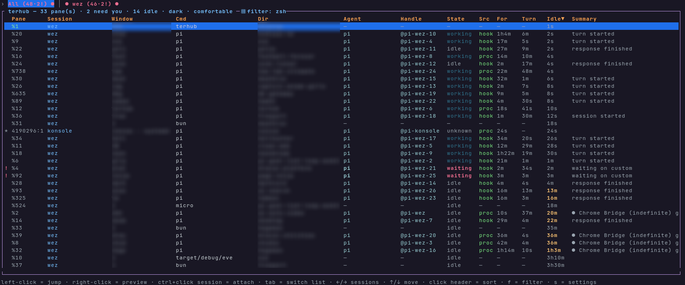

# terhub

Terminal-first session hub over tmux. One fullscreen TUI (plus a plain CLI)
to see every session and pane, know which agents need you, jump to them,
and drive them — from scripts, rules, MCP clients, a loopback web dashboard,
or other hosts over SSH. Full Rust, mouse-friendly, non-vim, and every key
rebindable.



## Install

Requires tmux 3.x on PATH and Rust 1.88+.

```sh
cargo install --path .
terhub init       # config + agent hooks + daemon, one shot
terhub            # opens the TUI
```

First run creates `~/.config/terhub/config.toml` with defaults.
Full manual: [GUIDE.md](GUIDE.md).

## The TUI

One-line session bar on top, one huge pane table, one status bar — no modes
except small popups:

- **Session bar.** `All` plus one segment per session, with attached marker
  (`●`/`○`), pane counts, and a worst-state dot (red = something needs you).
  `←`/`→` filters the table immediately, `Enter` attaches, `Alt+1..8` jumps
  to tabs.
- **Pane table.** Every pane: attention mark (`!` needs you, `+` marked,
  `*` focused, `✓` already seen), pane id, session, window, command, repo
  dir, agent, state, source (`hook` = agent-reported fact, `proc` = binary
  found, `scr` = screen guess), time in state, last turn, idle age, and a
  summary carrying the prompt or error line that decided the state.
- **States that matter are red.** Waiting, error, stuck, and quota-limited
  rows shout; working/idle are quiet. The filter chip (`◼`) names every
  filter hiding rows so one is never silently active.
- **Preview on demand.** Right-click or `p`: fullscreen scrollable reader
  over the pane's last 500 lines with its own ANSI colors, live CPU, and —
  in git repos — branch plus diff shortstat.
- **Filters.** `f` searches (or just start typing); `!` excludes. The
  standing exclusion from `[ui] filter` is always on. Name multi-token
  filters in settings (`s` → Filters) and cycle them with `ctrl+f`.
- **Marks & bulk.** `Space` marks rows file-manager style; `x`/`a` act on
  the whole marked set under one confirmation.
- **Sorting.** Recency sort by default; click any header (or `o`) to sort.

Keys (all rebindable in `[keys]`):

`n` new · `r` rename · `x` kill · `d` detach · `a` attend · `p` preview ·
`t` theme · `v` density · `s` settings · `o` sort · `f` filter ·
`ctrl+f` saved filters · `space` mark · `u` unmark · `h` hide quiet shells ·
`w` spawn agent · `e` restart · `z` freeze/thaw · `m` hosts · `b` bulk ·
`F5` refresh · `q` quit · `?` help (twice for the legend)

## Daemon + hooks

`terhubd` holds the live agent registry. Hook events from agents are
authoritative; identity comes from the process tree and states from screen
patterns, re-polled every 2 seconds. Every transition lands in the ledger
(`~/.local/share/terhub/activity.jsonl`), which powers stats, reports,
timelines, and per-pane history.

Agent states: `working`, `waiting` (needs you), `error` (needs you),
`idle`, `stuck` (needs you: no CPU for 10+ minutes), `limited` (needs you:
quota/rate wall, paused until reset — never a crash), `unknown`.

## Tray icon (KDE/Plasma)

```sh
terhub tray
```

A StatusNotifierItem until killed: red when something needs you, teal when
agents are done, gray + strikethrough when the daemon is down. Counts live
in the hover tooltip; clicking focuses the open hub or starts one.

## CLI

```
terhub list|peek            # panes as text / overlay
terhub status-line          # one line for tmux status-right
terhub stats|report|activity|recap|timeline
terhub automation list|test # rules with delay + cooldown + cap
terhub mcp                  # MCP stdio server
terhub serve --port 8080    # loopback web dashboard
terhub host|fleet ...       # agents across hosts over SSH
terhub send <pane> <text>   # drive a pane from scripts
```

See `terhub --help` and [GUIDE.md](GUIDE.md) for the rest.

## Dev

```
cargo test
cargo clippy --all-targets -- -D warnings
cargo fmt --check
```
